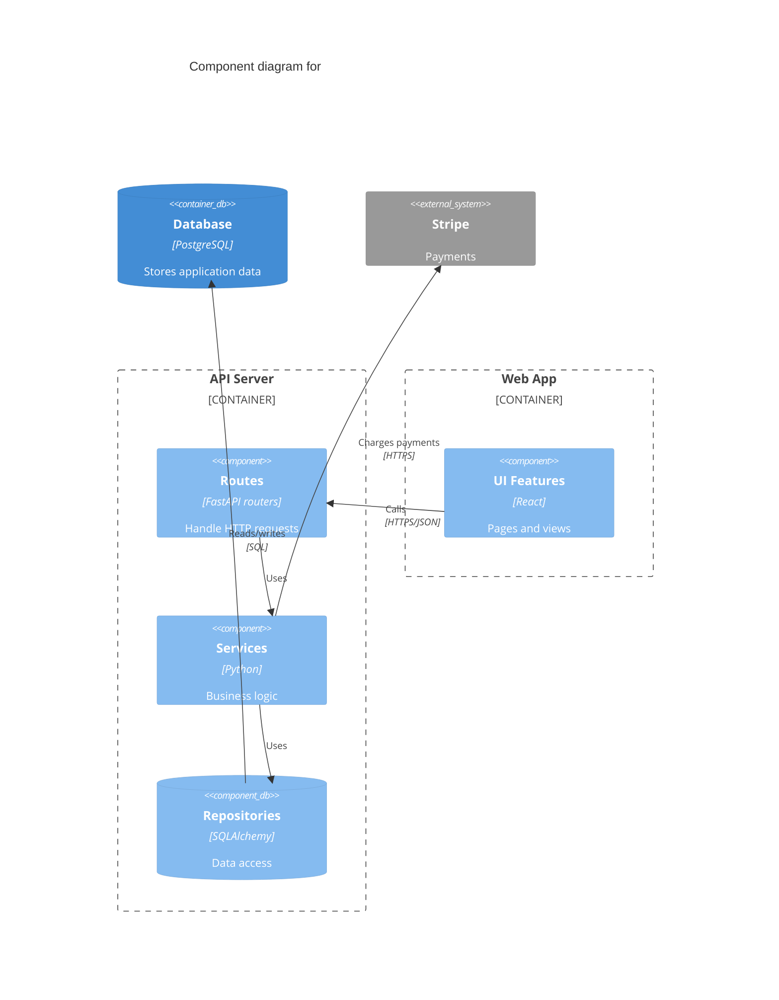

# Diagramma — Specification

**Version:** 0.6
**Purpose:** A locally run web app. You paste a GitHub repo URL, the backend analyses the repo, and the frontend shows a C4-style **Component diagram** of the *entire application* as a Mermaid graph. Past diagrams are kept in a history list so you can reopen them.

### Changes from v0.5
- The split view is a custom component instead of `react-resizable-panels` (§4.3). Keyboard shortcuts: **Alt+1** folds/unfolds the code pane, **Alt+2** the diagram pane.
- The diagram is always drawn on a light canvas with Mermaid's default theme: Mermaid's dark C4 theme leaves container and relation labels nearly unreadable. The rest of the UI follows the system theme.
- Saving text identical to the generated output clears the edit (it is not an edit). `PUT`/`DELETE …/edits/{format}` return the updated record.

### Changes from v0.4
- **Copy replaces download.** The UI copies the Mermaid text to the clipboard; the `.mmd` file download button and the `/download` endpoint are gone.

### Changes from v0.3
- The UI is now a **split view**: an editable Mermaid code pane (1/3) and the rendered diagram (2/3). Either pane can be folded so you see only the code or only the diagram. The separate "Mermaid source" tab is gone.
- Edits to the Mermaid code can be saved back to the history entry (new `PATCH` endpoint).

### Changes from v0.2
- Backend is now **Python + FastAPI** (frontend stays React + TypeScript).
- Repos are assumed to be **your own or trusted ones** (for study), so security hardening is reduced to basic hygiene.
- This spec now describes a **basic first implementation (MVP)**. Everything else is in the progressive roadmap (§12), not in scope for the first build.

---

## 1. Goals

1. Enter a GitHub repo URL in the UI and get a diagram of the **whole application**.
2. The diagram is a **C4 Component diagram** (https://c4model.com/diagrams/component) rendered with Mermaid, using the same or similar symbols.
3. View it in-app and **copy the raw Mermaid (`.mmd`) text** to use in any other Mermaid viewer.
4. Keep a **history** of generated diagrams and reopen them without re-analysing.
5. Runs entirely on your machine. The only network use is `git clone` from GitHub.

### Non-goals
- Persons/actors in the diagram. Class-level detail. Runtime/dynamic analysis.
- Multi-user, auth, hosting. Multi-file/split output. LLM features.

---

## 2. "Whole application" in C4 terms

A C4 Component diagram normally zooms into one container. Diagramma draws the whole app in **one diagram**:

| C4 element | Meaning in Diagramma | Mermaid construct |
|---|---|---|
| **Container** | A runnable/deployable unit: service, web app, worker, CLI, library, monorepo package | `Container_Boundary` |
| **Component** | A cohesive module/feature folder inside a container | `Component` |
| **Data store / queue** | Databases or queues used by the app | `ComponentDb`, `ContainerDb`, `ComponentQueue` |
| **External system** | Third-party services detected from dependencies/config | `System_Ext` |
| **Relationship** | Dependency between components, containers or externals | `Rel` |

No `Person` elements.

---

## 3. Architecture

```
┌──────────────────────────── Browser ─────────────────────────────┐
│  React + TypeScript (Vite)                                        │
│  URL input · history · Mermaid viewer · copy                      │
└───────────────┬───────────────────────────────────────────────────┘
                │ HTTP/JSON + SSE (localhost)
┌───────────────▼───────────────────────────────────────────────────┐
│  FastAPI backend                                                  │
│  Job runner ─► Analysis pipeline ─► Mermaid renderers             │
│  SQLite (history) · clone cache on disk                           │
└───────────────────────────────────────────────────────────────────┘
```

- Mermaid is **rendered in the browser** (`mermaid` npm package). The backend only produces Mermaid *text* plus the intermediate model.
- Dev: backend on `127.0.0.1:8787`, Vite dev server on `5173` (proxying `/api`).
- Run mode: FastAPI also serves the built frontend, so one command starts everything.

---

## 4. Frontend (React + TypeScript)

### 4.1 Layout

A top bar for input, a collapsible history sidebar, and below the bar a **horizontal split**: code editor on the left (1/3 of the working area), rendered diagram on the right (2/3).

```
┌─────────────────────────────────────────────────────────────────────┐
│ ☰  Diagramma  [ https://github.com/owner/repo ] [ref] [Generate]    │
├────────┬──────────────────────────┬─────────────────────────────────┤
│History │ Mermaid code        [‹]  │ Diagram   (C4|Flowchart) [›]    │
│(fold-  │ ───────────────────────  │                                 │
│ able)  │ C4Component              │                                 │
│ ▸ a    │   title ...              │      (pan / zoom rendering)     │
│ ▸ b    │   Container_Boundary(... │                                 │
│ ▸ c    │   ...                    │                                 │
│        │ ───────────────────────  │                                 │
│        │ ● Rendered OK  [Reset]   │  [Copy .mmd]                    │
│        │ [Save]                   │                                 │
├────────┴──────────────────────────┴─────────────────────────────────┤
│  1/3  editor                       2/3  diagram                      │
└─────────────────────────────────────────────────────────────────────┘
```

**Split behaviour**
- Default sizes: code pane **33%**, diagram pane **67%** of the width next to the history sidebar.
- A draggable divider lets you resize; double-click the divider resets to 1/3 : 2/3.
- **Foldable panes:** each pane has a fold button (and keyboard shortcuts). Three states:
  1. **Split** (default): both visible.
  2. **Code only:** diagram pane folded to a thin rail; code takes the full width.
  3. **Diagram only:** code pane folded to a thin rail; diagram takes the full width.
  The rail has a button to unfold. At least one pane is always open; folding the last open pane is not allowed.
- The fold state and divider position are remembered across reloads (`localStorage`).
- The history sidebar is also foldable (to a thin rail) so the diagram can use the full width.
- Below ~900 px width the panes stack vertically (code on top) with the same fold behaviour.

### 4.2 MVP features
- **Input:** accepts `https://github.com/owner/repo` and `owner/repo`, with an optional branch/tag/SHA field. Basic client-side validation.
- **Progress:** stage-by-stage status while the job runs (Cloning → Scanning → Detecting → Rendering), streamed via SSE. Errors shown as readable messages.
- **Code pane (editable Mermaid):**
  - A code editor (CodeMirror 6) with line numbers, monospace font, and basic Mermaid syntax highlighting (or plain text if no Mermaid grammar is available).
  - Shows the Mermaid text of the **active format** (C4 or Flowchart). Switching format switches the text; each format keeps its own edits.
  - **Live preview:** edits re-render the diagram after a short debounce (~400 ms). If the text is invalid, the last good render stays visible and the error (with line number when Mermaid provides it) is shown in a status bar under the editor.
  - **Reset** returns the text to the generated version. A dirty marker shows when the text differs from what is saved.
  - **Save** stores the edited text on the history entry (so the fixed version survives reload/restart). Re-generating the repo never overwrites saved edits silently: the original generated text is kept alongside, and a Reset restores it.
- **Diagram pane:** renders the current editor text with pan/zoom and fit-to-screen. The **C4 / Flowchart** toggle sits in this pane's header. If C4 fails to render, the error is shown and the flowchart is offered.
- **Export:** **Copy .mmd** puts the *current editor text* (including unsaved edits) of the active format on the clipboard. There is no file download.
- **History:** sidebar list of generated diagrams (repo, ref, short SHA, date, container/component counts). Click to reopen from storage; delete entry. Re-submitting the same repo+ref at the same commit reuses the existing entry.
- Light/dark following the system theme.

### 4.3 Stack
- React 18, TypeScript (strict), Vite.
- TanStack Query for API data; small local state otherwise.
- Tailwind CSS.
- `mermaid` (pinned version), `securityLevel: "strict"`, raised `maxTextSize`/`maxEdges`.
- `react-zoom-pan-pinch` for pan/zoom.
- `@uiw/react-codemirror` (CodeMirror 6) for the code pane.
- A small purpose-built split component (CSS grid + pointer events) for the draggable, foldable split. It was chosen over `react-resizable-panels` because folded panes must stay mounted (editor and render keep their state) and because every behaviour (rails, 1/3 reset, persistence, stacking) is unit-testable without a browser layout engine.
- API types **generated from FastAPI's OpenAPI schema** with `openapi-typescript`, so the contract stays in sync with the backend.
- Tests: Vitest + React Testing Library.

---

## 5. Backend (FastAPI)

### 5.1 Stack
- Python 3.12, FastAPI + Uvicorn, Pydantic v2 (models and API schemas).
- `sse-starlette` for progress streaming.
- Git via the system `git` (subprocess, `--depth 1`).
- SQLite via `sqlite3` or SQLModel; tiny schema, no ORM complexity required.
- Parsing: `tree-sitter` with `tree-sitter-language-pack` (grammars for JS/TS/Python in MVP).
- Graph work: plain `collections.Counter` edge tables (the graphs are small and one-directional; `networkx` was not needed).
- Packaging/env: `uv`. Tests: `pytest`. Lint/format: `ruff`.
- **Performance note:** the analysis is mostly file I/O and parsing in tree-sitter (native code), which Python handles well. The job runs in a worker process pool so the API stays responsive. If a profile on a large repo shows a bottleneck, only the analysis stage would be swapped for another implementation; the API and frontend do not change.

### 5.2 API (all under `/api`, bound to `127.0.0.1`)

| Method & path | Purpose |
|---|---|
| `POST /api/diagrams` | Body `{ url, ref? }`. Creates a job; returns `{ jobId }`, or `{ diagramId }` if an identical repo+ref+commit already exists. |
| `GET /api/jobs/{jobId}/events` | SSE: `{stage, message}` events, then `done {diagramId}` or `error {code, message}`. |
| `GET /api/diagrams` | History list (summary fields). |
| `GET /api/diagrams/{id}` | Full record: both Mermaid texts, metadata, warnings. |
| `PUT /api/diagrams/{id}/edits/{format}` | Body `{ text }`, `format` is `c4` or `flowchart`. Saves the user's edited Mermaid text. `DELETE` on the same path discards the edit (Reset). |
| `DELETE /api/diagrams/{id}` | Remove from history. |
| `GET /api/health` | Liveness + version. |

Errors use one shape: `{ "error": { "code", "message" } }` with codes like `INVALID_URL`, `REPO_NOT_FOUND`, `AUTH_REQUIRED`, `CLONE_FAILED`, `NOTHING_DETECTED`.

### 5.3 Persistence
One SQLite file in the user data dir (`$DIAGRAMMA_DATA_DIR`, default `~/.local/share/diagramma/diagramma.db`). `ref` is stored as `''` when none was given and `repo_url` lowercased, so the UNIQUE constraint behaves:

```
diagrams(
  id TEXT PK, repo_url TEXT, owner TEXT, name TEXT, ref TEXT, commit_sha TEXT,
  created_at TEXT, container_count INT, component_count INT,
  mermaid_c4 TEXT, mermaid_flowchart TEXT,            -- as generated, never modified
  edited_c4 TEXT NULL, edited_flowchart TEXT NULL,    -- user's saved edits (NULL = none)
  model_json TEXT,
  warnings_json TEXT, tool_version TEXT
)
UNIQUE (repo_url, ref, commit_sha)
```
Clones go to `~/.cache/diagramma/repos/`. Generated diagrams do not depend on the cache afterwards.

### 5.4 Jobs
In-process job registry plus a `ProcessPoolExecutor` (default 2 workers). One job at a time per repo. Progress events are pushed to the SSE stream. A global timeout (default 10 min) ends stuck jobs.

### 5.5 Basic safety (trusted repos only)
Because you only analyse your own or trusted repos, heavy sandboxing is out of scope. We keep simple hygiene:
- Accept only `https://github.com/...` URLs (also prevents accidental `file://`/arbitrary-host clones).
- Analysis is **static only**: never execute repo code or install its dependencies.
- Bind to `127.0.0.1`; CORS limited to the local frontend origin.
- Escape text placed into Mermaid so odd names cannot break the diagram.
- Private repos: optional `GITHUB_TOKEN` read from the backend environment; never logged or returned.

---

## 6. Analysis pipeline

```
URL ─► Fetch ─► Scan ─► Detect ─► Model ─► Render ─► {c4, flowchart}
       (clone)  (files) (containers, (graph)  (Mermaid text)
                         components,
                         relations,
                         externals)
```

Stages communicate only via the model, so each is testable on its own and emits a progress event.

---

## 7. Intermediate model (Pydantic)

```python
class Component(BaseModel):
    id: str; name: str
    role: Literal["controller","service","repository","ui","model","util","config","gateway","other"]
    technology: str | None
    paths: list[str]
    description: str | None
    weight: int                  # file count / LOC
    evidence: list[str]

class Container(BaseModel):
    id: str; name: str
    kind: Literal["webapp","api","service","worker","cli","library","other"]
    technology: str
    path: str
    description: str | None
    components: list[Component]

class External(BaseModel):
    id: str; name: str
    kind: Literal["system","database","queue"]
    technology: str | None
    evidence: list[str]

class Relation(BaseModel):
    source: str; target: str
    label: str                   # "Uses", "Reads/writes", "Calls", ...
    technology: str | None
    strength: int                # number of underlying import edges

class Model(BaseModel):
    system_name: str
    containers: list[Container]
    externals: list[External]
    relations: list[Relation]
    warnings: list[str]
```

The model is stored with each diagram and exposed through the API (and the generated TS types), so later features such as a details panel need no re-analysis.

---

## 8. MVP detection rules (deliberately simple)

Heuristic, deterministic, and every element keeps an `evidence` note.

**Languages supported in the MVP:** TypeScript/JavaScript and Python. Other languages fall back to directory + manifest detection with a warning.

**Containers**
- `docker-compose.yml` services (strongest signal).
- Monorepo workspaces (`package.json` workspaces, `pnpm-workspace.yaml`) and sub-folders containing their own manifest (`package.json`, `pyproject.toml`, `requirements.txt`).
- Kind from dependencies: web framework → `api`; React/Vue/Angular/Svelte/Next → `webapp`; `bin`/CLI entry → `cli`; no entrypoint → `library`.
- No markers → a single container named after the repo.

**Components**
- Each container's source root (`src/`, `app/`, `lib/`, or the package folder) → one component per top-level feature/module folder, never per file.
- Role from folder/file names (`controllers`, `routes`, `services`, `repositories`, `models`, `components`, `pages`, `middleware`, …).
- Files directly in the source root are grouped into one "Core" component.
- Tests, fixtures, mocks, docs, build output and generated code are excluded.

**Relationships**
- Parse imports with tree-sitter → file-level graph → roll up to component edges, then to container edges (cross-package imports, docker-compose `depends_on`, HTTP base-URL env vars when obvious).
- Parallel edges collapse into one labelled edge. Label from the role pair (e.g. controller→service "Uses", service→repository "Reads/writes via").

**External systems & data stores**
- Small built-in catalogue (Postgres, MySQL, MongoDB, Redis, Kafka, RabbitMQ, S3, Stripe, SendGrid, …) matched by dependency names, docker-compose images, and env var names.
- Databases/queues use the cylinder/queue symbols.

**Readability (basic)**
- If components exceed a cap (default 60), merge the smallest siblings into "Other <container>" nodes and add a warning. Anything smarter is on the roadmap.

---

## 9. Mermaid output

Both dialects are generated from the same model and stored. Output is deterministic (stable ordering), so the same commit always produces identical text.

### 9.1 Native `C4Component` (default)

IDs are sanitised to `[A-Za-z0-9_]`, labels escaped, and a header comment records repo, ref, commit SHA, date and tool version.

### 9.2 Flowchart fallback
Standard `flowchart` with one `subgraph` per container, C4-style colours via `classDef`, cylinders for databases, and node text as **Name / [Component: Tech] / description**. Renders in virtually every Mermaid viewer and copes better with large diagrams.

---

## 10. Project layout

```
diagramma/
  backend/
    pyproject.toml
    app/
      main.py              # FastAPI app, static frontend mount
      api/                 # routes, SSE, error handlers
      jobs/                # job registry, worker pool
      db.py                # SQLite access
      analysis/
        fetch.py           # URL validation, git clone
        scan.py            # file walker, ignore rules
        parse.py           # tree-sitter import extraction (JS/TS, Python)
        containers.py
        components.py
        relations.py
        externals.py       # + catalogue.yaml
        reduce.py          # basic cap/merge
      render/
        c4.py
        flowchart.py
        escape.py
      models.py            # Pydantic model + API schemas
    tests/
      fixtures/            # tiny sample repos
  frontend/
    package.json
    src/
      App.tsx
      components/          # RepoForm, HistoryList, SplitLayout, CodePane, DiagramPane, StatusBar, ProgressPanel
      api/                 # generated types + client + SSE hook
  SPEC.md
```

---

## 11. First-build milestones and acceptance

**Milestones**
1. **Skeleton:** FastAPI health route, Vite app, Mermaid renders a hard-coded diagram, OpenAPI → TS type generation wired up.
2. **Fetch & scan:** URL validation, clone, scanner, job + SSE progress visible in the UI.
3. **Containers & externals:** manifest and docker-compose detection; container-level diagram end-to-end (input → render → copy).
4. **Components & relations:** folder/role conventions and import graph for TS/JS and Python; both renderers.
5. **History:** SQLite persistence, sidebar, reopen and delete.
6. **Editor split view:** (can be built right after milestone 1, since it only needs text) resizable 1/3 : 2/3 split, fold states, live preview with error bar, save/reset of edits.

**Acceptance (MVP)**
1. Pasting a GitHub URL and pressing Generate shows progress and ends with a rendered whole-app diagram.
2. Containers appear as boundaries with components inside; databases/externals use distinct symbols; cross-container relationships are present; no person elements.
3. Copying the `.mmd` text and pasting it into an external Mermaid viewer renders the same diagram.
4. C4/Flowchart toggle works; a failed C4 render offers the flowchart.
4a. The screen opens with the code pane at ~1/3 and the diagram at ~2/3; the divider is draggable.
4b. Each pane can be folded, giving code-only or diagram-only views; the last open pane cannot be folded; layout persists across reloads.
4c. Editing the code re-renders live; invalid text keeps the previous render and shows the error; Save persists the edit across restarts; Reset restores the generated text.
5. Diagrams persist in the history across restarts and reopen instantly.
6. Re-submitting an unchanged repo reuses the existing entry.
7. Same commit + version produces byte-identical Mermaid text.
8. An unsupported-language repo still yields a coarser valid diagram with a warning.

---

## 12. Progressive roadmap (not in the first build)

Roughly in the order I'd suggest:

1. **Details panel:** click a component to see paths, role, technology, evidence and its incoming/outgoing relations (data already in the model).
2. **More languages:** Go, Java, C#, Ruby, Rust, PHP.
3. **Smarter components:** import-graph community detection (Louvain) when folder conventions give nothing; framework markers (`@Controller`, Spring, Django apps, Rails).
4. **Smarter readability:** hub nodes (logger/config) drawn once, weak-edge pruning, container-level fallback for huge repos.
5. **History upgrades:** rename, search, re-run button, compare two commits of the same repo.
6. **Cancel jobs** and richer progress.
7. **Export:** SVG/PNG download.
8. **Per-repo overrides** (`diagramma.config.yaml`): rename, hide, merge, add components/externals/labels; later a UI to edit them.
9. **Local path input** (analyse an already-cloned folder, no GitHub needed).
10. **Optional LLM enrichment** for names, descriptions and labels (opt-in).
11. **Performance experiments** if Python becomes too slow on large repos (e.g. Rust/Go analysis module behind the same interface).

---

## 13. Risks

| Risk | Mitigation |
|---|---|
| Mermaid `C4Component` is experimental; layout can be cramped for big systems | Flowchart fallback, component cap, pan/zoom |
| Heuristics misclassify some repos | Evidence stored per element; overrides on the roadmap |
| "Component" boundaries are subjective | Folder conventions first, smarter clustering later |
| Dynamic dependencies (DI, reflection, runtime URLs) are invisible to static analysis | Documented limitation; use docker-compose and framework hints where possible |
| Python slowness on very large repos | Process pool, native tree-sitter; swap-out path noted in roadmap |
