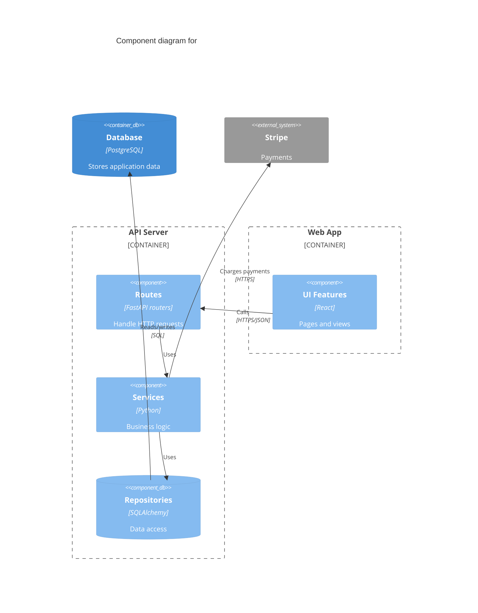

# Diagramma — Specification

**Version:** 0.10
**Purpose:** A locally run web app. You paste a GitHub repo URL, the backend analyses the repo, and the frontend shows a C4-style **Component diagram** of the *entire application* as a Mermaid graph. Past diagrams are kept in a history list so you can reopen them.

### Changes from v0.9
- **New view: Imports (M9, §9.4), for React applications.** A fourth tab shows every JS/TS file of a React container as a box with an edge to each file it imports. Boxes are **colour- and shape-coded by what the file is**: entry point, page/route, component, hook, state/context, API/service layer, database access, util, types, config. External boxes are drawn for databases, third-party services (from the catalogue) and API-client packages (axios, react-query, swr, Apollo, ...). A colour legend with counts sits above the diagram.
- The model gains `files` and `file_imports` (§7). Tool version 0.4.0, so diagrams made before are regenerated on the next submit; opening Imports on an old diagram answers `409 IMPORTS_UNAVAILABLE`, as does a repository with no React.
- The view is file-level and has no depth: it always uses depth 1 in the views and edits endpoints, and the UI hides the Depth control on this tab.

### Changes from v0.8
- **M8 is built, in the simpler form.** The Dependencies tab, the `layers` format (views and edits), relation provenance (`evidence`), tool version 0.3.0 and schema v3 are implemented (§9.3). What was deliberately *not* built, and is listed in the roadmap: **layer bands** (a subgraph per layer: explicit "Layer N" titles, but much taller drawings), **hub marking** in this view, drawing upward edges on demand, and per-container filtering. The view is a plain top-down `flowchart TB` with the layer number and a colour per layer on every box.
- Added to the design while building: `max_span` in the summary; components with no import link are left out and counted (`isolated`); diagrams generated before provenance existed answer `409 LAYERS_UNAVAILABLE` with "submit the repository again"; schema v3 drops the SQL check on `edits.format` (the API validates it) so new view formats need no migration; a view that fails to load keeps the previous one on screen, read-only, with the tabs still usable.

### Changes from v0.7
- **New view: the Dependency graph** (§9.3): a layered graph built from import statements, in which foundations sit at the bottom and entry points on top, cycles are reported instead of hidden, and redundant or very long edges are left out. It is a third view next to Flowchart and C4. **Built as M8 in a simpler form in v0.9 (see below).**
- Relations record where their evidence comes from (`evidence`, §7), so this view can use import edges only.
- Milestones are now written **M1, M2, …** (§11). The deeper-components work is recorded as **M7** (built) and the Dependency graph as **M8** (planned); acceptance items 9-14 cover them.

### Changes from v0.6
- **Deeper components.** A container is no longer split only by its top-level folders: components form a **tree** (folders, sub-folders and, for containers up to 300 source files, individual files; §8). Relations are stored between the leaves and **rolled up to a chosen depth** when rendering. The UI has a **Depth** control; the default is the deepest level that still shows at most 60 boxes.
- **A clearer flowchart.** The flowchart is now the default view (Mermaid's C4 layout cannot cope with nested boundaries or dense graphs) and shows nested subgraphs, role colours, edge thickness and `×N` counts for coupling, no label for the default "Uses", edges that cross a group attached to the sibling groups instead of every file, and **hubs** (shared modules) drawn once with a "used by N" note instead of N incoming lines (§9.2). C4 remains available and draws every edge.
- **Edits are per view.** A saved edit belongs to one (format, depth). New `GET …/views/{format}/{depth}`; `PUT`/`DELETE …/edits/{format}/{depth}` (§5.2). Schema v2 stores edits in their own table and migrates v1 databases in place (§5.3).
- The 60-component cap now applies to **top-level** components only; deeper levels are chosen with Depth.

### Changes from v0.5
- The split view is a custom component instead of `react-resizable-panels` (§4.3). Keyboard shortcuts: **Alt+1** folds/unfolds the code pane, **Alt+2** the diagram pane.
- The diagram is always drawn on a light canvas with Mermaid's default theme: Mermaid's dark C4 theme leaves container and relation labels nearly unreadable. The rest of the UI follows the system theme.
- Saving text identical to the generated output clears the edit (it is not an edit). `PUT`/`DELETE …/edits/{format}` return the updated record.

### Changes from v0.4
- **Copy replaces download.** The UI copies the Mermaid text to the clipboard; the `.mmd` file download button and the `/download` endpoint are gone.

### Changes from v0.3
- The UI is now a **split view**: an editable Mermaid code pane (1/3) and the rendered diagram (2/3). Either pane can be folded so you see only the code or only the diagram. The separate "Mermaid source" tab is gone.
- Edits to the Mermaid code can be saved back to the history entry (new `PATCH` endpoint).

### Changes from v0.2
- Backend is now **Python + FastAPI** (frontend stays React + TypeScript).
- Repos are assumed to be **your own or trusted ones** (for study), so security hardening is reduced to basic hygiene.
- This spec now describes a **basic first implementation (MVP)**. Everything else is in the progressive roadmap (§12), not in scope for the first build.

---

## 1. Goals

1. Enter a GitHub repo URL in the UI and get a diagram of the **whole application**.
2. The diagram is a **C4 Component diagram** (https://c4model.com/diagrams/component) rendered with Mermaid, using the same or similar symbols.
3. View it in-app and **copy the raw Mermaid (`.mmd`) text** to use in any other Mermaid viewer.
4. Keep a **history** of generated diagrams and reopen them without re-analysing.
5. Runs entirely on your machine. The only network use is `git clone` from GitHub.
6. A **Dependency graph** view of the same repo: a layered graph built from import statements that shows what depends on what and which way the code flows (M8, §9.3).

### Non-goals
- Persons/actors in the diagram. Class-level detail. Runtime/dynamic analysis.
- Multi-user, auth, hosting. Multi-file/split output. LLM features.

---

## 2. "Whole application" in C4 terms

A C4 Component diagram normally zooms into one container. Diagramma draws the whole app in **one diagram**:

| C4 element | Meaning in Diagramma | Mermaid construct |
|---|---|---|
| **Container** | A runnable/deployable unit: service, web app, worker, CLI, library, monorepo package | `Container_Boundary` |
| **Component** | A cohesive module inside a container: a feature folder, a sub-folder, or (small containers) a file. Components nest; folders that contain others are *groups* | `Component`, nested `Boundary` for groups (C4); nested `subgraph` (flowchart) |
| **Data store / queue** | Databases or queues used by the app | `ComponentDb`, `ContainerDb`, `ComponentQueue` |
| **External system** | Third-party services detected from dependencies/config | `System_Ext` |
| **Relationship** | Dependency between components, containers or externals | `Rel` |

No `Person` elements.

---

## 3. Architecture

```
┌──────────────────────────── Browser ─────────────────────────────┐
│  React + TypeScript (Vite)                                        │
│  URL input · history · Mermaid viewer · copy                      │
└───────────────┬───────────────────────────────────────────────────┘
                │ HTTP/JSON + SSE (localhost)
┌───────────────▼───────────────────────────────────────────────────┐
│  FastAPI backend                                                  │
│  Job runner ─► Analysis pipeline ─► Mermaid renderers             │
│  SQLite (history) · clone cache on disk                           │
└───────────────────────────────────────────────────────────────────┘
```

- Mermaid is **rendered in the browser** (`mermaid` npm package). The backend only produces Mermaid *text* plus the intermediate model.
- Dev: backend on `127.0.0.1:8787`, Vite dev server on `5173` (proxying `/api`).
- Run mode: FastAPI also serves the built frontend, so one command starts everything.

---

## 4. Frontend (React + TypeScript)

### 4.1 Layout

A top bar for input, a collapsible history sidebar, and below the bar a **horizontal split**: code editor on the left (1/3 of the working area), rendered diagram on the right (2/3).

```
┌─────────────────────────────────────────────────────────────────────┐
│ ☰  Diagramma  [ https://github.com/owner/repo ] [ref] [Generate]    │
├────────┬──────────────────────────┬─────────────────────────────────┤
│History │ Mermaid code        [‹]  │ Diagram  (Flowchart|C4)  [›]    │
│(fold-  │ ───────────────────────  │                                 │
│ able)  │ C4Component              │                                 │
│ ▸ a    │   title ...              │      (pan / zoom rendering)     │
│ ▸ b    │   Container_Boundary(... │                                 │
│ ▸ c    │   ...                    │                                 │
│        │ ───────────────────────  │                                 │
│        │ ● Rendered OK  [Reset]   │  [Copy .mmd]                    │
│        │ [Save]                   │                                 │
├────────┴──────────────────────────┴─────────────────────────────────┤
│  1/3  editor                       2/3  diagram                      │
└─────────────────────────────────────────────────────────────────────┘
```

**Split behaviour**
- Default sizes: code pane **33%**, diagram pane **67%** of the width next to the history sidebar.
- A draggable divider lets you resize; double-click the divider resets to 1/3 : 2/3.
- **Foldable panes:** each pane has a fold button (and keyboard shortcuts). Three states:
  1. **Split** (default): both visible.
  2. **Code only:** diagram pane folded to a thin rail; code takes the full width.
  3. **Diagram only:** code pane folded to a thin rail; diagram takes the full width.
  The rail has a button to unfold. At least one pane is always open; folding the last open pane is not allowed.
- The fold state and divider position are remembered across reloads (`localStorage`).
- The history sidebar is also foldable (to a thin rail) so the diagram can use the full width.
- Below ~900 px width the panes stack vertically (code on top) with the same fold behaviour.

### 4.2 MVP features
- **Input:** accepts `https://github.com/owner/repo` and `owner/repo`, with an optional branch/tag/SHA field. Basic client-side validation.
- **Progress:** stage-by-stage status while the job runs (Cloning → Scanning → Detecting → Rendering), streamed via SSE. Errors shown as readable messages.
- **Code pane (editable Mermaid):**
  - A code editor (CodeMirror 6) with line numbers, monospace font, and basic Mermaid syntax highlighting (or plain text if no Mermaid grammar is available).
  - Shows the Mermaid text of the **active format** (C4 or Flowchart). Switching format switches the text; each format keeps its own edits.
  - **Live preview:** edits re-render the diagram after a short debounce (~400 ms). If the text is invalid, the last good render stays visible and the error (with line number when Mermaid provides it) is shown in a status bar under the editor.
  - **Reset** returns the text to the generated version. A dirty marker shows when the text differs from what is saved.
  - **Save** stores the edited text on the history entry (so the fixed version survives reload/restart). Re-generating the repo never overwrites saved edits silently: the original generated text is kept alongside, and a Reset restores it.
- **Diagram pane:** renders the current editor text with pan/zoom and fit-to-screen. The **Flowchart / C4** toggle sits in this pane's header; **Flowchart is the default**. If C4 fails to render, the error is shown and the flowchart is offered.
- **Dependency graph tab (M8, built).** A third tab, labelled **Dependencies**, next to Flowchart and C4. It uses the same Depth control, editor, Copy and per-view saved edits (format `layers`), and adds a summary strip: layers, upward dependencies, longest chain, and what was left out (§9.3).
- **Depth control** (above the split, shown when the model has more than one level): buttons 1…max (a dropdown beyond 8), the default level marked. Each (format, depth) is its own view with its own editor text, draft and saved edit; the header shows how many boxes and relations the view draws, how many shared modules were drawn once instead of wired, and warns above 150 boxes.
- **Export:** **Copy .mmd** puts the *current editor text* (including unsaved edits) of the active format on the clipboard. There is no file download.
- **History:** sidebar list of generated diagrams (repo, ref, short SHA, date, container/component counts). Click to reopen from storage; delete entry. Re-submitting the same repo+ref at the same commit reuses the existing entry.
- Light/dark following the system theme.

### 4.3 Stack
- React 18, TypeScript (strict), Vite.
- TanStack Query for API data; small local state otherwise.
- Tailwind CSS.
- `mermaid` (pinned version), `securityLevel: "strict"`, raised `maxTextSize`/`maxEdges`.
- `react-zoom-pan-pinch` for pan/zoom.
- `@uiw/react-codemirror` (CodeMirror 6) for the code pane.
- A small purpose-built split component (CSS grid + pointer events) for the draggable, foldable split. It was chosen over `react-resizable-panels` because folded panes must stay mounted (editor and render keep their state) and because every behaviour (rails, 1/3 reset, persistence, stacking) is unit-testable without a browser layout engine.
- API types **generated from FastAPI's OpenAPI schema** with `openapi-typescript`, so the contract stays in sync with the backend.
- Tests: Vitest + React Testing Library.

---

## 5. Backend (FastAPI)

### 5.1 Stack
- Python 3.12, FastAPI + Uvicorn, Pydantic v2 (models and API schemas).
- `sse-starlette` for progress streaming.
- Git via the system `git` (subprocess, `--depth 1`).
- SQLite via `sqlite3` or SQLModel; tiny schema, no ORM complexity required.
- Parsing: `tree-sitter` with `tree-sitter-language-pack` (grammars for JS/TS/Python in MVP).
- Graph work: plain `collections.Counter` edge tables (the graphs are small and one-directional; `networkx` was not needed).
- Packaging/env: `uv`. Tests: `pytest`. Lint/format: `ruff`.
- **Performance note:** the analysis is mostly file I/O and parsing in tree-sitter (native code), which Python handles well. The job runs in a worker process pool so the API stays responsive. If a profile on a large repo shows a bottleneck, only the analysis stage would be swapped for another implementation; the API and frontend do not change.

### 5.2 API (all under `/api`, bound to `127.0.0.1`)

| Method & path | Purpose |
|---|---|
| `POST /api/diagrams` | Body `{ url, ref? }`. Creates a job; returns `{ jobId }`, or `{ diagramId }` if an identical repo+ref+commit already exists. |
| `GET /api/jobs/{jobId}/events` | SSE: `{stage, message}` events, then `done {diagramId}` or `error {code, message}`. |
| `GET /api/diagrams` | History list (summary fields). |
| `GET /api/diagrams/{id}` | Full record: both Mermaid texts, metadata, warnings. |
| `GET /api/diagrams/{id}/views/{format}/{depth}` | One rendering: the generated text, the user's saved edit for that exact view (or null), and the number of boxes, edges and hubs drawn. `depth` is 1…`max_depth` (else `INVALID_DEPTH`). From M8, `format` may also be `layers` (§9.3) and the response carries a `layers` summary object. |
| `PUT /api/diagrams/{id}/edits/{format}/{depth}` | Body `{ text }`. Saves the user's edited text for that view (text equal to the generated one clears the edit). `DELETE` on the same path discards it (Reset). Both return the view. |
| `DELETE /api/diagrams/{id}` | Remove from history. |
| `GET /api/health` | Liveness + version. |

Errors use one shape: `{ "error": { "code", "message" } }` with codes like `INVALID_URL`, `REPO_NOT_FOUND`, `AUTH_REQUIRED`, `CLONE_FAILED`, `NOTHING_DETECTED`.

### 5.3 Persistence
One SQLite file in the user data dir (`$DIAGRAMMA_DATA_DIR`, default `~/.local/share/diagramma/diagramma.db`). `ref` is stored as `''` when none was given and `repo_url` lowercased, so the UNIQUE constraint behaves:

```
diagrams(
  id TEXT PK, repo_url TEXT, owner TEXT, name TEXT, ref TEXT, commit_sha TEXT,
  commit_date TEXT, created_at TEXT, container_count INT, component_count INT,
  max_depth INT, auto_depth INT,                      -- deepest component level; default view
  mermaid_c4 TEXT, mermaid_flowchart TEXT,            -- as generated at auto_depth, never modified
  model_json TEXT,
  warnings_json TEXT, tool_version TEXT
)
UNIQUE (repo_url, ref, commit_sha)

edits(                                                -- the user's saved edits, one per view
  diagram_id TEXT FK -> diagrams ON DELETE CASCADE, format TEXT ('c4'|'flowchart'),  -- 'layers' from M8
  depth INT, text TEXT,
  PRIMARY KEY (diagram_id, format, depth)
)
```
`PRAGMA user_version` is 2 (3 from M8: the `edits` table no longer restricts `format` in SQL, the API validates it, so formats such as `layers` need no further migration; the v2→v3 step rebuilds only that table and keeps every row). A version-1 database (edits as two columns on `diagrams`) is migrated in place: those edits move to the `edits` table at depth 1. Other depths are rendered on demand from `model_json`, so only the auto-depth texts are stored.
Clones go to `~/.cache/diagramma/repos/`. Generated diagrams do not depend on the cache afterwards.

### 5.4 Jobs
In-process job registry plus a `ProcessPoolExecutor` (default 2 workers). One job at a time per repo. Progress events are pushed to the SSE stream. A global timeout (default 10 min) ends stuck jobs.

### 5.5 Basic safety (trusted repos only)
Because you only analyse your own or trusted repos, heavy sandboxing is out of scope. We keep simple hygiene:
- Accept only `https://github.com/...` URLs (also prevents accidental `file://`/arbitrary-host clones).
- Analysis is **static only**: never execute repo code or install its dependencies.
- Bind to `127.0.0.1`; CORS limited to the local frontend origin.
- Escape text placed into Mermaid so odd names cannot break the diagram.
- Private repos: optional `GITHUB_TOKEN` read from the backend environment; never logged or returned.

---

## 6. Analysis pipeline

```
URL ─► Fetch ─► Scan ─► Detect ─► Model ─► Render ─► {c4, flowchart}
       (clone)  (files) (containers, (graph)  (Mermaid text)
                         components,
                         relations,
                         externals)
```

Stages communicate only via the model, so each is testable on its own and emits a progress event.

---

## 7. Intermediate model (Pydantic)

```python
class Component(BaseModel):
    id: str; name: str
    role: Literal["controller","service","repository","ui","model","util","config","gateway","other"]
    technology: str | None
    paths: list[str]
    description: str | None
    weight: int                  # LOC (a group: the sum of its parts)
    evidence: list[str]
    parent: str | None           # id of the enclosing group; None = directly under the container
    depth: int                   # 1 = directly under the container
    kind: Literal["group","folder","file"]
    file_count: int              # source files in this component's subtree

class Container(BaseModel):
    id: str; name: str
    kind: Literal["webapp","api","service","worker","cli","library","other"]
    technology: str
    path: str
    description: str | None
    components: list[Component]

class External(BaseModel):
    id: str; name: str
    kind: Literal["system","database","queue"]
    technology: str | None
    evidence: list[str]

class Relation(BaseModel):
    source: str; target: str
    label: str                   # "Uses", "Reads/writes", "Calls", ...
    technology: str | None
    strength: int                # number of underlying import edges
    evidence: list[Literal["import","compose","manifest","env"]]
                                 # what the edge is based on; the Dependency graph (§9.3) uses
                                 # only edges with "import", and merging edges unions this set

class Model(BaseModel):
    system_name: str
    containers: list[Container]
    externals: list[External]
    relations: list[Relation]
    files: list[SourceFile]      # M9: JS/TS files of React containers (else empty)
    file_imports: list[FileImport]
    warnings: list[str]

class SourceFile(BaseModel):     # M9, §9.4
    id: str; path: str; name: str; container: str; loc: int
    kind: Literal["entry","page","component","hook","state","api","db","util","types","config"]
    packages: list[str]          # bare npm packages imported
class FileImport(BaseModel):
    source: str; target: str; count: int   # target: a file id, or an external system/database id
```

The model is stored with each diagram and exposed through the API (and the generated TS types), so later features such as a details panel need no re-analysis.

---

## 8. MVP detection rules (deliberately simple)

Heuristic, deterministic, and every element keeps an `evidence` note.

**Languages supported in the MVP:** TypeScript/JavaScript and Python. Other languages fall back to directory + manifest detection with a warning.

**Containers**
- `docker-compose.yml` services (strongest signal).
- Monorepo workspaces (`package.json` workspaces, `pnpm-workspace.yaml`) and sub-folders containing their own manifest (`package.json`, `pyproject.toml`, `requirements.txt`).
- Kind from dependencies: web framework → `api`; React/Vue/Angular/Svelte/Next → `webapp`; `bin`/CLI entry → `cli`; no entrypoint → `library`.
- No markers → a single container named after the repo.

**Components**
- Each container's source root (`src/`, `app/`, `lib/`, or the package folder) is turned into a **tree**: one component per folder, nested to at most **6 levels**. Pass-through folders (no files of their own, one sub-folder) are merged into one level (`shared/a/b/c` → "Shared / A / B / C").
- **Small containers (up to 300 source files)** also get one component per **file**, so the deepest level is every module. **Larger containers** stop at folders: a folder is split only when it holds at least 4 files and has sub-folders, and a split folder's own files form one "Files" component.
- Role from folder/file names (`controllers`, `routes`, `services`, `repositories`, `models`, `components`, `pages`, `middleware`, …); a sub-folder or file with no recognisable name inherits its parent's role.
- Files directly in the source root are grouped into one "Core" component. Empty `__init__.py` files are not components, but imports that resolve to them still count (they attach to the heaviest component of their folder).
- Tests, fixtures, mocks, docs, build output and generated code are excluded.

**Relationships**
- Parse imports with tree-sitter → file-level graph → edges between the **leaf** components (cross-package imports, docker-compose `depends_on`, HTTP base-URL env vars when obvious). One import statement is one dependency (`from pkg import a, b` depends on the submodules `a`, `b`, not additionally on `pkg/__init__`).
- Rendering **rolls the leaf edges up** to the chosen depth: every leaf is represented by its ancestor at that level; parallel edges merge and their import counts add up.
- Label from the role pair (e.g. controller→service "Uses", service→repository "Reads/writes via").

**External systems & data stores**
- Small built-in catalogue (Postgres, MySQL, MongoDB, Redis, Kafka, RabbitMQ, S3, Stripe, SendGrid, …) matched by dependency names, docker-compose images, and env var names.
- Databases/queues use the cylinder/queue symbols.

**Readability (basic)**
- If **top-level** components exceed a cap (default 60), merge the smallest into "Other <container>" (absorbing their sub-trees) and add a warning. Deeper levels are not capped: the user chooses them with Depth, and the default depth is the deepest one that shows at most 60 boxes.

---

## 9. Mermaid output

Both dialects are generated from the same model and stored. Output is deterministic (stable ordering), so the same commit always produces identical text.

### 9.1 Native `C4Component` (default)

IDs are sanitised to `[A-Za-z0-9_]`, labels escaped, and a header comment records repo, ref, depth, commit SHA, commit date and tool version. Folder groups are drawn as nested `Boundary(...)` inside the container's `Container_Boundary`. Mermaid's C4 layout copes poorly with nesting and dense graphs, so C4 is best at low depth; every relation between boxes is drawn.

### 9.2 Flowchart (default view)
Standard `flowchart LR` with one `subgraph` per container and **nested subgraphs for folder groups** (file counts in their titles), cylinders for databases, and node text as **Name / [Component: Tech] / description** (files stay compact). Renders in virtually every Mermaid viewer without special directives and copes with large diagrams far better than C4. To stay readable it:
- colours each box by **role** (`classDef`) and draws a "container"/"external" palette for the rest;
- draws **edge thickness** from the number of imports (1 = default, +1px per doubling, max 7px) and prints `×N` for N > 1; the default label "Uses" is not printed, other labels and technologies are;
- attaches edges that **cross a group boundary** to the sibling groups just below the common parent (across containers and to external systems: to the level-1 component), while edges inside a group keep file-level detail; parallel edges merge;
- marks **hubs** (shared modules such as utils/config/core): a component with at least 8 dependents *and* at least 25% of all dependents is drawn once with a dashed border and "used by N", and its incoming edges are not drawn (a comment line lists them). Databases and other external systems are never hubs.

### 9.4 Imports (React file graph) — M9, built

A `flowchart LR`, built only from import statements, for containers that are React apps (`react`, `react-dom`, `react-native`, `next` or `preact` declared in the manifest or imported by a file; other containers of a monorepo are left out). One box per file that imports or is imported, grouped in a subgraph per top-level folder under `src/`.

**File kinds** (first rule that matches wins; heuristics on path, name and content, `analysis/filekind.py`):

| Kind | Colour | Shape | Rule |
|---|---|---|---|
| Entry point | orange | circle | calls `createRoot`/`hydrateRoot`/`ReactDOM.render`/`registerRootComponent` |
| Page / route | pink | subroutine | JSX in `pages/`, `routes/`, `screens/`, `views/`, or Next `page`/`layout`/... |
| State / context | purple | hexagon | `createContext`, `createSlice`, `configureStore`, `createStore`; or a state library (zustand, jotai, redux, ...) in a file without JSX |
| Hook | green | stadium | exports `useXxx` (and has no JSX, or is itself named `useXxx`) |
| Component | blue | rectangle | contains JSX |
| Types | light grey | rectangle | `types/` folder or a file named `types` |
| Database access | red | cylinder | imports a catalogue database, or lives in `db/`, `prisma/`, `repositories/`, ... |
| API / service layer | yellow | parallelogram | imports an API-client package, calls `fetch`/`XMLHttpRequest`/`WebSocket`, lives in `api/`, `services/`, ..., or is named `*Api`/`*Service`/`*Client`; Next `pages/api` and `route.ts` |
| Config | blue-grey | rectangle | named or placed as config/constants/settings/env |
| Util / lib | grey | rectangle | everything else |
| External API / client | dark yellow | trapezoid | API-client package, or a catalogue service or queue |
| External database | salmon | cylinder | catalogue database |

**Noise control.** A file imported by at least 8 others and 25% of all importers (the same rule as the flowchart's hubs) is drawn once with a dashed border and "used by N" instead of with its incoming edges; files with no import link are counted, not drawn; other npm packages (react, router, UI kits) are counted, not drawn. The legend strip reports all three. Colours come from the backend (`legend`), so the Mermaid text and the legend cannot drift apart.

### 9.3 Dependency graph (layered) — M8, built (simplified)

The flowchart (§9.2) is a **structural map**: groups, folders, who is next to whom. The Dependency graph answers a different question: **in which direction does the code depend, and how many levels deep is that chain?** It orders the components into **layers** using the import statements only, so shared foundations sit at the bottom and entry points at the top. Edges point from the importer to what it imports.

**Input.** The boxes at the chosen depth (the same roll-up as §9.2) plus external systems that some import references. Only relations whose `evidence` contains `import` are used. Compose `depends_on`, manifest and env-var evidence are weaker and would invent layers, so they are excluded; databases and queues reached only through them do not appear.

**Algorithm** (pure and deterministic, `analysis/layering.py`; ties are always broken by id). Components with no import link at this depth are not part of the graph; they are counted as `isolated`.
1. **Break cycles by ordering, not by collapsing.** Order the nodes with the weighted Eades-Lin-Smyth greedy heuristic (weight = import count) so that dependents come first. An edge pointing against that order is an **upward edge**. Collapsing each strongly connected component into one node is wrong for real code: Django at package level is *one* component containing 15 of its 19 packages, which would erase the structure; ordering gives 10 layers with 34 upward edges out of 114.
2. **Layer.** Over the remaining (forward) edges, layer 0 = depends on nothing; `layer(n) = 1 + max(layer(d))` over its dependencies `d`. Every forward edge therefore goes from a strictly higher layer to a strictly lower one. External systems are always layer 0.
3. **Transitive reduction.** Omit a forward edge `A→C` when another path `A→…→C` exists (the dependency is still true, and it is implied). Measured on real repos: FastAPI template depth 2, 125 → 74 edges; Flask depth 2, 91 → 45; Django depth 1, 80 → 22.
4. **Long edges.** A forward edge spanning more than `MAX_SPAN` layers (default 3, to be tuned in M8) is not drawn; each affected node shows "+N deeper". Long edges are what turn a layered drawing into a tangle (measured on the FastAPI template).
5. **Upward edges are not drawn by default.** They are the cycle structure and would dominate the picture (Django: 34 red lines over 22 forward ones). Instead every endpoint shows "↑N", and the summary lists the strongest ones. A toggle to draw them is on the roadmap.
6. **Hubs.** *Not applied in this view* (deferred, §12): in the prototype the reduction already removed most of their edges.

**Output.** A `flowchart TB` whose text is the view:
- **plain top-down ranking** (no bands): importers above, what they import below. Every box shows its **layer number** (`L3`) and is coloured by layer (eight soft colours, cycling), so the layering is visible even where Mermaid's own ranking differs slightly. The explicit-bands variant (one `subgraph` per layer, "Layer N" titles, invisible `~~~` ordering links) renders correctly too but draws much taller (Django at depth 1 about 3,500px) and is deferred;
- the **container name** is added to each box when the model has several containers (so a frontend/backend split is visible); `×N` on edges with more than one import; external systems as cylinders in layer 0;
- nodes with upward edges get a red dashed border and "↑N";
- header comments give the counts below. Output is deterministic, copyable and editable like every other view; saved edits are per (`layers`, depth).

**Summary** (the `layers` object of the view response): `layer_count`, `layer_sizes[]`, `nodes`, `edges_drawn`, `edges_transitive_omitted`, `edges_long_omitted`, `max_span`, `upward_edges`, `longest_chain` (= `layer_count`), `isolated`, `top_upward[]` (the 10 strongest: source and target names, strength).

**Scope limits for M8.** Whole system only (no per-container filter); only languages with import analysis (TS/JS, Python); one depth at a time.

**Evidence the design rests on** (prototype on four real repos, depth in brackets): FastAPI template (2) 57 nodes / 125 edges, 10 layers, no cycles. Flask (2) 36 / 116, 14 layers, 25 upward edges. Django (1) 19 / 114, 10 layers, 34 upward edges, 22 forward edges after reduction. Layer bands with the unreduced edge set were unreadable; with reduction the forward edges read cleanly and the remaining clutter was long edges and upward edges, hence rules 4 and 5.

---

## 10. Project layout

```
diagramma/
  backend/
    pyproject.toml
    app/
      main.py              # FastAPI app, static frontend mount
      api/                 # routes, SSE, error handlers
      jobs/                # job registry, worker pool
      db.py                # SQLite access
      analysis/
        fetch.py           # URL validation, git clone
        scan.py            # file walker, ignore rules
        parse.py           # tree-sitter import extraction (JS/TS, Python)
        containers.py
        components.py
        relations.py
        externals.py       # + catalogue.yaml
        reduce.py          # top-level cap/merge
        layering.py        # cycle breaking, layers, reduction: pure functions (M8)
      render/
        view.py            # depth roll-up, grouped edges, hubs
        c4.py
        flowchart.py
        layers.py          # Dependency graph text and summary (M8)
        escape.py
      models.py            # Pydantic model + API schemas
    tests/
      fixtures/            # tiny sample repos
  frontend/
    package.json
    src/
      App.tsx
      components/          # RepoForm, HistoryList, SplitLayout, CodePane, DiagramPane, StatusBar, ProgressPanel
      api/                 # generated types + client + SSE hook
  SPEC.md
```

---

## 11. First-build milestones and acceptance

**Milestones** (written M1, M2, … everywhere; status is tracked in `progress.md`)
- **M1 Skeleton:** FastAPI health route, Vite app, Mermaid renders a hard-coded diagram, OpenAPI → TS type generation wired up.
- **M2 Fetch & scan:** URL validation, clone, scanner, job + SSE progress visible in the UI.
- **M3 Containers & externals:** manifest and docker-compose detection; container-level diagram end-to-end (input → render → copy).
- **M4 Components & relations:** folder/role conventions and import graph for TS/JS and Python; both renderers.
- **M5 History:** SQLite persistence, sidebar, reopen and delete.
- **M6 Editor split view:** (can be built right after M1, since it only needs text) resizable 1/3 : 2/3 split, fold states, live preview with error bar, save/reset of edits.
- **M7 Deeper components and a clearer view** (built): components as a tree with a Depth control, depth roll-up of relations, grouped edges and hubs in the flowchart, per-view edits, schema v2.
- **M9 Imports view** (built, §9.4): React file model (`files`, `file_imports`) and file-kind classifier; the `imports` format; the Imports tab with a colour legend.
- **M8 Dependency graph view** (built in a simpler form, §9.3): relation provenance; layering with cycle breaking, transitive reduction and long-edge handling; the `layers` format in the views and edits endpoints; the Dependencies tab with its summary strip.

**Acceptance (M1-M6, MVP)**
1. Pasting a GitHub URL and pressing Generate shows progress and ends with a rendered whole-app diagram.
2. Containers appear as boundaries with components inside; databases/externals use distinct symbols; cross-container relationships are present; no person elements.
3. Copying the `.mmd` text and pasting it into an external Mermaid viewer renders the same diagram.
4. C4/Flowchart toggle works; a failed C4 render offers the flowchart.
4a. The screen opens with the code pane at ~1/3 and the diagram at ~2/3; the divider is draggable.
4b. Each pane can be folded, giving code-only or diagram-only views; the last open pane cannot be folded; layout persists across reloads.
4c. Editing the code re-renders live; invalid text keeps the previous render and shows the error; Save persists the edit across restarts; Reset restores the generated text.
5. Diagrams persist in the history across restarts and reopen instantly.
6. Re-submitting an unchanged repo reuses the existing entry.
7. Same commit + version produces byte-identical Mermaid text.
8. An unsupported-language repo still yields a coarser valid diagram with a warning.

**Acceptance (M7)**
9. Components nest several levels deep; the Depth control switches levels; the default depth draws at most 60 boxes; every (format, depth) view has its own text, draft and saved edit, and edits survive a reload without leaking to other views.
10. The flowchart stays readable on dense code: edges between groups attach to the groups, shared modules (hubs) are drawn once with a "used by N" count, and the header states how many were handled that way.

**Acceptance (M8, Dependency graph)**
11. The Dependencies tab shows a layered graph: layer numbers are shown, every drawn forward edge goes from a higher layer to a lower one, and external systems sit in layer 0.
12. Cyclic code still layers: for a repo with import cycles (Flask, Django) the view shows layers, never collapses a large cycle into one node, reports the number of upward edges and lists the 10 strongest.
13. Only import-derived edges are used: an edge supported only by compose, manifest or env evidence never appears.
14. Readable and honest by default: no drawn forward edge spans more than `MAX_SPAN` layers; the summary states how many edges were omitted as transitive, as too long, and as upward; the text is deterministic, renders in the pinned Mermaid and in a second Mermaid version, and the view for Django at its default depth is computed in under one second.

---

## 12. Progressive roadmap (not in the first build)

Roughly in the order I'd suggest:

1. **Details panel:** click a component to see paths, role, technology, evidence and its incoming/outgoing relations (data already in the model). It would also list exactly who depends on a hub or on a layer, and the upward edges of the Dependency graph.
2. **More languages:** Go, Java, C#, Ruby, Rust, PHP.
3. **Smarter components:** import-graph community detection (Louvain) when folder conventions give nothing; framework markers (`@Controller`, Spring, Django apps, Rails).
4. **Smarter readability:** weak-edge pruning, container-level fallback for huge repos; for the Dependency graph: a toggle to draw upward edges, strict layer alignment, and per-container filtering. (Hub nodes drawn once are done for the flowchart, §9.2.)
   **Dependency graph extras:** layer bands with explicit "Layer N" titles, hub marking, and per-container filtering.
   **Layer rules:** let the user forbid upward dependencies (or name allowed layer directions) and get a report of violations.
5. **History upgrades:** rename, search, re-run button, compare two commits of the same repo.
6. **Cancel jobs** and richer progress.
7. **Export:** SVG/PNG download.
8. **Per-repo overrides** (`diagramma.config.yaml`): rename, hide, merge, add components/externals/labels; later a UI to edit them.
9. **Local path input** (analyse an already-cloned folder, no GitHub needed).
10. **Optional LLM enrichment** for names, descriptions and labels (opt-in).
11. **Performance experiments** if Python becomes too slow on large repos (e.g. Rust/Go analysis module behind the same interface).

---

## 13. Risks

| Risk | Mitigation |
|---|---|
| Mermaid `C4Component` is experimental; layout is poor for nested or dense diagrams | Flowchart is the default view; depth control; hub and edge grouping; component cap; pan/zoom |
| Heuristics misclassify some repos | Evidence stored per element; overrides on the roadmap |
| "Component" boundaries are subjective | Folder conventions first, smarter clustering later |
| Dynamic dependencies (DI, reflection, runtime URLs) are invisible to static analysis | Documented limitation; use docker-compose and framework hints where possible |
| Python slowness on very large repos | Process pool, native tree-sitter; swap-out path noted in roadmap |
| Mutually importing code (Django) collapses into one cycle | The Dependency graph orders nodes and reports upward edges instead of collapsing cycles (§9.3) |
| Long edges and upward edges turn a layered drawing into a tangle | Transitive reduction, `MAX_SPAN`, upward edges summarised not drawn; tuned against four reference repos in M8 |
| Layering is only as good as the import graph (aliases, dynamic imports are missed) | Known limits are documented; provenance (`evidence`) keeps weaker evidence out of this view |
